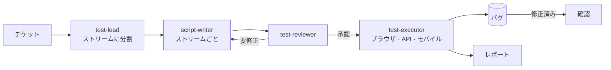

<div align="center">

# testkit

**コーディングエージェントのためのオープンソース QA チーム。**
チケットからテストを計画・作成・レビュー・実行し、証跡付きでバグを起票して修正を確認します。

[English](README.md) · [Tiếng Việt](README.vi.md) · [简体中文](README.zh-CN.md) · **日本語** · [한국어](README.ko.md)

[](LICENSE)
[](https://agentskills.io/specification)

対応：**Claude Code** · **Codex** · **Cursor** · **Gemini CLI** · **GitHub Copilot**

</div>

---

## 3 ステップで始める

**1. `testkit` コマンドをインストール**（マシンごとに一度）：

```bash
curl -fsSL https://testkit.example.com/install.sh | bash          # macOS / Linux
```
```powershell
irm https://testkit.example.com/install.ps1 | iex                 # Windows PowerShell
```

**2. プロジェクトに testkit を追加：**

```bash
cd my-project
testkit init
```

**3. コーディングエージェントでプロジェクトを開き、チケットをテスト：**

```text
/testkit-config          いくつかの質問に答える（URL、テストアカウント）
/testkit-run PROJ-123    計画 → 作成 → レビュー → 実行 → レポート
```

結果は `qa/runs/PROJ-123/` に保存され、判定・集計・バグ一覧は `report.md` にあります。

> インストール用サイトの公開までは `testkit.example.com` は仮のアドレスです。今はリポジトリをクローンして `./install.sh`（Windows：`.\install.ps1`）を実行してください。

## 何ができる？

コーディングエージェントで次のように入力します。例は Claude Code の書式です。他のツールは[呼び出し方](#対応するコーディングエージェント)を参照してください。

| やりたいこと | 入力 |
|---|---|
| **チケットを一通りテストする** | `/testkit-run PROJ-123` |
| 修正後にバグを再テストする | `/testkit-verify --ticket PROJ-123` |
| 実装前に仕様をレビューする | `/testkit-spec-review PROJ-123` |
| リリースのテスト計画を作る | `/testkit-plan-release v2.4` |
| 結果を Word や Excel で渡す | `/testkit-export PROJ-123 all --format xlsx` |
| 合格したケースを自動回帰テストにする | `/testkit-automate PROJ-123` |
| アクセシビリティ・性能・見た目の変化を確認する | `/quality-audits PROJ-123 a11y` |
| UAT シナリオと検収議事録を用意する | `/testkit-uat PROJ-123` |
| 実際のアプリからユーザーガイドやリリースノートを書く | `/testkit-guide guide checkout PROJ-123` |
| スプリントの品質指標を見る | `/testkit-metrics sprint-42 --from 2026-11-01 --to 2026-11-14` |
| testkit にプロジェクトを理解させる | `/testkit-knowledge learn` |
| 決定事項を記録して二度と聞かれないようにする | `/testkit-knowledge remember "クーポンは併用不可"` |

API テスト（Hurl）、データベースとメールの確認、テストデータ、モバイルテスト（Maestro）は、チケットに必要なときに `testkit-run` の中で自動的に実行されます。個別に呼び出す必要はありません。

## 仕組み



- **test-lead** はチケット・ドキュメント・コードを読み、並行実行できるストリームに作業を分けます。
- **script-writer** はストリームごとにテストケースを書き、ブラウザで実際の UI を確認します。
- **test-reviewer** はすべての期待結果をドキュメントと照合し、エッジケースと権限の網羅性を確認します。
- **test-executor** は専用のテストアカウントでケースを実行し、スクリーンショットとログを証跡として保存し、バグを起票します。

各ストリームは独立したヘッドレス Chrome で動くため、ログインやデータを共有しません。

## 既存プロジェクトとプロジェクトの記憶

- **既存の資産と共存します。** `testkit init` はあなたのスキル、エージェント、ファイルを上書きしません。同名のスキルやエージェントはそのまま残し、警告を表示します。`CLAUDE.md`、`AGENTS.md`、`GEMINI.md` には印付きの短いブロックを追加するだけで、他の部分には触れません。
- **プロジェクトを理解します。** `/testkit-knowledge learn` はコード、API 仕様、ドキュメント、既存のエージェント向け指示を調べ、`qa/knowledge/project-map.md` を作成します。内容は機能、画面、エンドポイント、ロール、環境、リスクの高い領域です。
- **決定事項を記憶します。** PO の回答、合意済みの挙動、「修正しない」判断は `qa/knowledge/decisions/` にファイルとして保存されます。エージェントは計画やレビューの前にそれを確認し、作業中に新しい決定を記録します。
- **ナレッジグラフ（任意）。** testkit はこれらを [Graphiti](https://github.com/getzep/graphiti) のナレッジグラフに索引し、意味で検索できるようにします。すでに動いているものがあれば再利用し、なければ `testkit graph up` で起動します（Docker と、LLM の API キーまたは Ollama が必要）。グラフがなくても、すべてファイルだけで動作します。

## 対応するコーディングエージェント

`testkit init` はマシン上のツールを自動検出します。自分で選ぶ場合：`testkit init --agents claude,codex`（または `all`）。

| ツール | スキルの呼び出し |
|---|---|
| Claude Code | `/testkit-run PROJ-123` |
| Codex | `$testkit-run PROJ-123` |
| Cursor | `/testkit-run PROJ-123` |
| GitHub Copilot | `/testkit-run PROJ-123` |
| Gemini CLI | 依頼：*「testkit-run スキルで PROJ-123 をテストして」* |

> Codex と Gemini CLI は、信頼済み（trusted）にしたフォルダでのみプロジェクトのスキルを読み込みます。

## プロジェクトに追加されるもの

```
my-project/
├── .claude/ .agents/ .codex/ …   コーディングエージェント用のスキルとエージェント（testkit が管理）
└── qa/
    ├── config.yml                環境、テストアカウント、ブラウザ、レポート形式
    ├── runs/PROJ-123/            計画、ケース、レビュー、結果、証跡、レポート
    ├── bugs/                     バグごとに 1 ファイル + index.md
    ├── knowledge/                プロジェクトマップ、決定事項、ドキュメント台帳
    └── accounts.local.json       テストアカウントのパスワード（git-ignore 済み）
```

`testkit update` で更新、`testkit doctor` でセットアップを確認できます。

## 標準で安全

- `qa/config.yml` に記載された URL だけを開きます。`allow_write: false` の環境では破壊的な操作をブロックします。
- あなたのブラウザやログイン状態には触れず、ストリームごとに新しい一時的な Chrome を使います。
- データベースは読み取り専用です。負荷テストとセキュリティスキャンは環境を許可するまで無効で、本番環境では決して実行しません。
- レポートにパスワードを残さず、ブラウザのテレメトリを無効にします。
- 費用が発生する操作や Jira への書き込みの前に確認を求めます。

<details>
<summary><b>インストールオプション</b></summary>

追加のテスト種別向けにツール群をインストールします：

```bash
curl -fsSL https://testkit.example.com/install.sh | bash -s -- --with api,automation
```

| グループ | インストール内容 | 用途 |
|---|---|---|
| `api` | Hurl | API テスト |
| `mail` | Mailpit | メール / OTP 確認 |
| `db` | psql、mysql クライアント | データベース確認 |
| `automation` | Node.js | Playwright 回帰スイート |
| `video` | ffmpeg | バグとガイドの動画 |
| `load` | k6 | 負荷テスト |
| `mobile` | Maestro（Java 17+ が必要） | モバイルアプリのテスト |
| `security` | Docker を確認 | OWASP ZAP ベースライン |
| `knowledge` | Docker 上の Graphiti（約 3.7 GB のダウンロード） | ナレッジグラフ |
| `office` | LibreOffice、poppler | 出力した Word のプレビュー |
| `agent-browser` | Node.js、agent-browser | 代替ブラウザツール |

`--with all` ですべて、`--yes` で確認を省略します。Windows ではインストーラ実行前に `$env:TESTKIT_WITH = "api,automation"` を設定してください。

基本インストールではコーディングエージェントを確認し（なければ Claude Code をインストール）、uv、browser-use CLI、pandoc をインストールし、Google Chrome を確認します。詳細：[docs/installation.md](docs/installation.md)。

</details>

<details>
<summary><b>全スキル</b></summary>

| スキル | 用途 |
|---|---|
| `testkit-run`、`testkit-verify`、`testkit-config`、`testkit-knowledge` | メインパイプライン、バグ確認、プロジェクト設定 |
| `testkit-spec-review`、`testkit-plan-release` | 要件レビュー、リリーステスト計画 |
| `test-case-standard`、`test-data` | テストケース形式とチェックリスト、テストデータ生成 |
| `browser-testing`、`api-testing`、`data-checks`、`mobile-testing` | ブラウザ、API、データベース/メール、モバイルのテスト実行 |
| `quality-audits` | アクセシビリティ、性能、画面比較、負荷、セキュリティ |
| `bug-reporting` | バグ形式、ライフサイクル、動画、Jira 対応付け |
| `testkit-automate` | Playwright 回帰スイートと CI テンプレート |
| `testkit-export`、`testkit-metrics`、`testkit-uat`、`testkit-guide` | Word/Excel/CSV 出力、指標とスライド、UAT、ユーザー文書 |
| `docx`、`pdf`、`xlsx`、`pptx` | [Anthropic](https://github.com/anthropics/skills) のドキュメント系スキル（Apache-2.0） |
| `browser-use` | ローカルの [browser-use](https://github.com/browser-use/browser-use) CLI から生成 |

</details>

## ドキュメント

- [インストールと公開](docs/installation.md)
- [利用ガイド](docs/usage-guide.md)

詳細ドキュメントは現在ベトナム語のみです。翻訳を歓迎します。

## コントリビューション

issue とプルリクエストを歓迎します：新しいスキル、対応エージェントの追加、翻訳、修正など。[CONTRIBUTING.md](CONTRIBUTING.md) を読み、プルリクエストの前に `python3 scripts/check-kit.py` を実行してください。[行動規範](CODE_OF_CONDUCT.md)を守り、脆弱性は [SECURITY.md](SECURITY.md) の方法で報告してください。

## ライセンス

[MIT](LICENSE)。同梱の `docx`、`pdf`、`xlsx`、`pptx` スキルは © Anthropic、Apache-2.0 です。[THIRD_PARTY_NOTICES.md](THIRD_PARTY_NOTICES.md) を参照してください。
