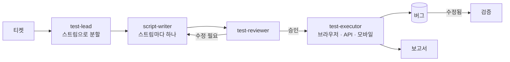

<div align="center">

# testkit

**코딩 에이전트를 위한 오픈소스 QA 팀.**
티켓에서 테스트를 계획·작성·검토·실행하고, 증거와 함께 버그를 등록하고 수정 사항을 검증합니다.

[English](README.md) · [Tiếng Việt](README.vi.md) · [简体中文](README.zh-CN.md) · [日本語](README.ja.md) · **한국어**

[](LICENSE)
[](https://agentskills.io/specification)

지원: **Claude Code** · **Codex** · **Cursor** · **Gemini CLI** · **GitHub Copilot**

</div>

---

## 3단계로 시작하기

**1. `testkit` 명령 설치** (컴퓨터마다 한 번):

```bash
curl -fsSL https://testkit.example.com/install.sh | bash          # macOS / Linux
```
```powershell
irm https://testkit.example.com/install.ps1 | iex                 # Windows PowerShell
```

**2. 프로젝트에 testkit 추가:**

```bash
cd my-project
testkit init
```

**3. 코딩 에이전트에서 프로젝트를 열고 티켓을 테스트:**

```text
/testkit-config          몇 가지 질문에 답하기 (URL, 테스트 계정)
/testkit-run PROJ-123    계획 → 작성 → 검토 → 실행 → 보고
```

결과는 `qa/runs/PROJ-123/`에 저장되며, 판정·집계·버그 목록은 `report.md`에 있습니다.

> 설치 사이트가 공개되기 전까지 `testkit.example.com`은 임시 주소입니다. 지금은 저장소를 클론한 뒤 `./install.sh`(Windows: `.\install.ps1`)를 실행하세요.

## 무엇을 할 수 있나요?

코딩 에이전트에 다음과 같이 입력합니다. 예시는 Claude Code 문법이며, 다른 도구는 [호출 방법](#지원하는-코딩-에이전트)을 참고하세요.

| 하고 싶은 일 | 입력 |
|---|---|
| **티켓 하나를 처음부터 끝까지 테스트** | `/testkit-run PROJ-123` |
| 개발자가 수정한 뒤 버그 재테스트 | `/testkit-verify --ticket PROJ-123` |
| 개발 전에 명세 검토 | `/testkit-spec-review PROJ-123` |
| 릴리스 테스트 계획 작성 | `/testkit-plan-release v2.4` |
| 결과를 Word나 Excel로 전달 | `/testkit-export PROJ-123 all --format xlsx` |
| 통과한 케이스를 자동 회귀 테스트로 전환 | `/testkit-automate PROJ-123` |
| 접근성·성능·화면 변화 확인 | `/quality-audits PROJ-123 a11y` |
| UAT 시나리오와 인수 확인서 준비 | `/testkit-uat PROJ-123` |
| 실제 앱으로 사용자 가이드나 릴리스 노트 작성 | `/testkit-guide guide checkout PROJ-123` |
| 스프린트 품질 지표 보기 | `/testkit-metrics sprint-42 --from 2026-11-01 --to 2026-11-14` |
| testkit이 프로젝트를 이해하게 하기 | `/testkit-knowledge learn` |
| 결정 사항을 기록해 다시 묻지 않게 하기 | `/testkit-knowledge remember "쿠폰은 중복 적용 불가"` |

API 테스트(Hurl), 데이터베이스·이메일 확인, 테스트 데이터, 모바일 테스트(Maestro)는 티켓에 필요할 때 `testkit-run` 안에서 자동으로 실행되므로 따로 호출할 필요가 없습니다.

## 동작 방식



- **test-lead**는 티켓·문서·코드를 읽고 병렬로 실행할 수 있는 스트림으로 작업을 나눕니다.
- **script-writer**는 스트림마다 테스트 케이스를 작성하며, 브라우저에서 실제 UI를 확인합니다.
- **test-reviewer**는 모든 기대 결과를 문서와 대조하고 엣지 케이스와 권한 커버리지를 확인합니다.
- **test-executor**는 전용 테스트 계정으로 케이스를 실행하고, 스크린샷과 로그를 증거로 저장하며, 버그를 등록합니다.

각 스트림은 독립된 헤드리스 Chrome에서 실행되므로 로그인이나 데이터를 공유하지 않습니다.

## 기존 프로젝트와 프로젝트 기억

- **기존 자산과 함께 동작합니다.** `testkit init`은 사용자의 스킬, 에이전트, 파일을 덮어쓰지 않습니다. 같은 이름의 스킬이나 에이전트는 그대로 두고 경고를 표시합니다. `CLAUDE.md`, `AGENTS.md`, `GEMINI.md`에는 표시가 붙은 짧은 블록만 추가하고 나머지 내용은 건드리지 않습니다.
- **프로젝트를 이해합니다.** `/testkit-knowledge learn`은 코드, API 명세, 문서, 기존 에이전트 지침을 살펴보고 `qa/knowledge/project-map.md`를 만듭니다. 기능, 화면, 엔드포인트, 역할, 환경, 위험 영역이 정리됩니다.
- **결정을 기억합니다.** PO의 답변, 합의된 동작, "수정 안 함" 판정은 `qa/knowledge/decisions/`에 파일로 저장됩니다. 에이전트는 계획과 검토 전에 이를 확인하고, 작업하면서 새 결정을 기록합니다.
- **지식 그래프(선택).** testkit은 이 모든 내용을 [Graphiti](https://github.com/getzep/graphiti) 지식 그래프에 색인해 의미로 검색할 수 있게 합니다. 이미 실행 중인 Graphiti가 있으면 재사용하고, 없으면 `testkit graph up`으로 새로 시작합니다(Docker와 LLM API 키 또는 Ollama 필요). 그래프가 없어도 모든 기능이 파일만으로 동작합니다.

## 지원하는 코딩 에이전트

`testkit init`은 컴퓨터의 도구를 자동으로 감지합니다. 직접 고르려면: `testkit init --agents claude,codex`(또는 `all`).

| 도구 | 스킬 호출 |
|---|---|
| Claude Code | `/testkit-run PROJ-123` |
| Codex | `$testkit-run PROJ-123` |
| Cursor | `/testkit-run PROJ-123` |
| GitHub Copilot | `/testkit-run PROJ-123` |
| Gemini CLI | 요청: *"testkit-run 스킬로 PROJ-123을 테스트해 줘"* |

> Codex와 Gemini CLI는 신뢰(trusted)로 표시한 폴더에서만 프로젝트 스킬을 불러옵니다.

## 프로젝트에 추가되는 것

```
my-project/
├── .claude/ .agents/ .codex/ …   코딩 에이전트용 스킬과 에이전트 (testkit이 관리)
└── qa/
    ├── config.yml                환경, 테스트 계정, 브라우저, 보고서 형식
    ├── runs/PROJ-123/            계획, 케이스, 검토, 결과, 증거, 보고서
    ├── bugs/                     버그마다 파일 하나 + index.md
    ├── knowledge/                프로젝트 맵, 결정 사항, 문서 목록
    └── accounts.local.json       테스트 계정 비밀번호 (git-ignore 처리)
```

`testkit update`로 업데이트하고, `testkit doctor`로 설정을 확인하세요.

## 기본적으로 안전

- `qa/config.yml`에 등록된 URL만 엽니다. `allow_write: false`인 환경에서는 파괴적인 작업을 막습니다.
- 사용자의 브라우저와 로그인을 건드리지 않으며, 스트림마다 새 임시 Chrome을 사용합니다.
- 데이터베이스는 읽기 전용입니다. 부하 테스트와 보안 스캔은 환경을 허용하기 전까지 꺼져 있고, 운영 환경에서는 절대 실행하지 않습니다.
- 보고서에 비밀번호를 남기지 않고, 브라우저 텔레메트리를 끕니다.
- 비용이 드는 작업이나 Jira에 쓰기 전에 먼저 묻습니다.

<details>
<summary><b>설치 옵션</b></summary>

다른 테스트 유형을 위한 도구 그룹을 설치합니다:

```bash
curl -fsSL https://testkit.example.com/install.sh | bash -s -- --with api,automation
```

| 그룹 | 설치 | 용도 |
|---|---|---|
| `api` | Hurl | API 테스트 |
| `mail` | Mailpit | 이메일 / OTP 확인 |
| `db` | psql, mysql 클라이언트 | 데이터베이스 확인 |
| `automation` | Node.js | Playwright 회귀 스위트 |
| `video` | ffmpeg | 버그·가이드 영상 |
| `load` | k6 | 부하 테스트 |
| `mobile` | Maestro (Java 17+ 필요) | 모바일 앱 테스트 |
| `security` | Docker 확인 | OWASP ZAP 기본 스캔 |
| `knowledge` | Docker의 Graphiti(약 3.7 GB 다운로드) | 지식 그래프 |
| `office` | LibreOffice, poppler | 내보낸 Word 미리보기 |
| `agent-browser` | Node.js, agent-browser | 대체 브라우저 도구 |

`--with all`은 전부 설치하고, `--yes`는 확인을 건너뜁니다. Windows에서는 설치 프로그램 실행 전에 `$env:TESTKIT_WITH = "api,automation"`을 설정하세요.

기본 설치는 코딩 에이전트를 확인하고(없으면 Claude Code 설치), uv, browser-use CLI, pandoc을 설치하며 Google Chrome을 확인합니다. 자세한 내용: [docs/installation.md](docs/installation.md).

</details>

<details>
<summary><b>전체 스킬</b></summary>

| 스킬 | 용도 |
|---|---|
| `testkit-run`, `testkit-verify`, `testkit-config`, `testkit-knowledge` | 메인 파이프라인, 버그 검증, 프로젝트 설정 |
| `testkit-spec-review`, `testkit-plan-release` | 요구사항 검토, 릴리스 테스트 계획 |
| `test-case-standard`, `test-data` | 테스트 케이스 형식과 체크리스트, 테스트 데이터 생성 |
| `browser-testing`, `api-testing`, `data-checks`, `mobile-testing` | 브라우저, API, 데이터베이스/이메일, 모바일 테스트 실행 |
| `quality-audits` | 접근성, 성능, 화면 비교, 부하, 보안 |
| `bug-reporting` | 버그 형식, 생명주기, 영상, Jira 매핑 |
| `testkit-automate` | Playwright 회귀 스위트와 CI 템플릿 |
| `testkit-export`, `testkit-metrics`, `testkit-uat`, `testkit-guide` | Word/Excel/CSV 내보내기, 지표와 슬라이드, UAT, 사용자 문서 |
| `docx`, `pdf`, `xlsx`, `pptx` | [Anthropic](https://github.com/anthropics/skills)의 문서 스킬 (Apache-2.0) |
| `browser-use` | 로컬 [browser-use](https://github.com/browser-use/browser-use) CLI에서 생성 |

</details>

## 문서

- [설치와 공개](docs/installation.md)
- [사용 가이드](docs/usage-guide.md)

자세한 문서는 현재 베트남어로만 제공됩니다. 번역 기여를 환영합니다.

## 기여하기

issue와 풀 리퀘스트를 환영합니다: 새 스킬, 더 많은 코딩 에이전트 지원, 번역, 수정. [CONTRIBUTING.md](CONTRIBUTING.md)를 읽고, 풀 리퀘스트 전에 `python3 scripts/check-kit.py`를 실행해 주세요. [행동 강령](CODE_OF_CONDUCT.md)을 지키고, 취약점은 [SECURITY.md](SECURITY.md)에 안내된 방법으로 제보해 주세요.

## 라이선스

[MIT](LICENSE). 포함된 `docx`, `pdf`, `xlsx`, `pptx` 스킬은 © Anthropic, Apache-2.0입니다. [THIRD_PARTY_NOTICES.md](THIRD_PARTY_NOTICES.md)를 참고하세요.
