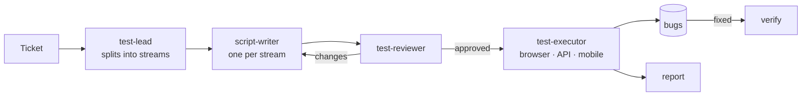

<div align="center">

# testkit

**An open-source QA team for your coding agent.**
Plan, write, review and run tests from a ticket. File bugs with evidence and verify fixes.

**English** · [Tiếng Việt](README.vi.md) · [简体中文](README.zh-CN.md) · [日本語](README.ja.md) · [한국어](README.ko.md)

[](LICENSE)
[](https://agentskills.io/specification)

Works with **Claude Code** · **Codex** · **Cursor** · **Gemini CLI** · **GitHub Copilot**

</div>

---

## Get started in 3 steps

**1. Install the `testkit` command** (once per machine):

```bash
curl -fsSL https://testkit.example.com/install.sh | bash          # macOS / Linux
```
```powershell
irm https://testkit.example.com/install.ps1 | iex                 # Windows PowerShell
```

**2. Add testkit to your project:**

```bash
cd my-project
testkit init
```

**3. Open the project in your coding agent and test a ticket:**

```text
/testkit-config          answer a few questions (URLs, test accounts)
/testkit-run PROJ-123    plan → write → review → run → report
```

Results are written to `qa/runs/PROJ-123/`. The verdict, totals and bugs are in `report.md`.

> `testkit.example.com` is a placeholder until the install site is published. For now, clone the repo and run `./install.sh` (Windows: `.\install.ps1`).

## What can I do?

Type these in your coding agent. The examples use Claude Code syntax; see [how to call a skill](#supported-coding-agents) in other tools.

| I want to… | Type |
|---|---|
| **Test a ticket end to end** | `/testkit-run PROJ-123` |
| Re-test bugs after developers fix them | `/testkit-verify --ticket PROJ-123` |
| Review a spec before coding starts | `/testkit-spec-review PROJ-123` |
| Write a test plan for a release | `/testkit-plan-release v2.4` |
| Send results as Word or Excel | `/testkit-export PROJ-123 all --format xlsx` |
| Turn passed cases into automated regression tests | `/testkit-automate PROJ-123` |
| Check accessibility, performance or visual changes | `/quality-audits PROJ-123 a11y` |
| Prepare UAT scripts and sign-off minutes | `/testkit-uat PROJ-123` |
| Write a user guide or release notes from the real app | `/testkit-guide guide checkout PROJ-123` |
| See quality metrics for a sprint | `/testkit-metrics sprint-42 --from 2026-11-01 --to 2026-11-14` |
| Teach testkit how your project works | `/testkit-knowledge learn` |
| Record a product decision so nobody asks again | `/testkit-knowledge remember "Coupons do not stack"` |

API tests (Hurl), database and email checks, test data and mobile tests (Maestro) run inside `testkit-run` when the ticket needs them. You don't have to call them separately.

## How it works



- **test-lead** reads the ticket, docs and code, and splits the work into streams that can run in parallel.
- **script-writer** writes test cases for each stream, checking the live UI in a browser.
- **test-reviewer** checks every expected result against the docs, and checks coverage of edge cases and permissions.
- **test-executor** runs the cases with its own test accounts, saves screenshots and logs as evidence, and files bugs.

Each stream runs in its own headless Chrome, so streams never share logins or data.

## Existing projects and project memory

- **Plays well with what you have.** `testkit init` never overwrites your own skills, agents or files. A skill or agent with the same name is kept, and you get a warning. testkit adds a short marked block to `CLAUDE.md`, `AGENTS.md` or `GEMINI.md` and leaves the rest of the file alone.
- **Understands your project.** `/testkit-knowledge learn` scans the code, API specs, docs and existing agent instructions. It writes `qa/knowledge/project-map.md`: features, screens, endpoints, roles, environments and risky areas.
- **Remembers decisions.** Answers from the PO, accepted behaviours and "won't fix" rulings are saved as files in `qa/knowledge/decisions/`. Agents check them before planning and reviewing, and record new ones as they work.
- **Knowledge graph (optional).** testkit indexes all of this in a [Graphiti](https://github.com/getzep/graphiti) knowledge graph for search by meaning. It reuses one you already run, or starts its own with `testkit graph up` (Docker, plus an LLM API key or Ollama). Without a graph, everything still works from the files.

## Supported coding agents

`testkit init` detects the tools on your machine. To choose them yourself: `testkit init --agents claude,codex` (or `all`).

| Tool | Call a skill |
|---|---|
| Claude Code | `/testkit-run PROJ-123` |
| Codex | `$testkit-run PROJ-123` |
| Cursor | `/testkit-run PROJ-123` |
| GitHub Copilot | `/testkit-run PROJ-123` |
| Gemini CLI | ask: *"use the testkit-run skill for PROJ-123"* |

> Codex and Gemini CLI only load project skills in folders you have marked as trusted.

## What testkit adds to your project

```
my-project/
├── .claude/ .agents/ .codex/ …   skills and agents for your coding agents (managed by testkit)
└── qa/
    ├── config.yml                environments, test accounts, browser, report formats
    ├── runs/PROJ-123/            plan, cases, reviews, results, evidence, report
    ├── bugs/                     one file per bug + index.md
    ├── knowledge/                project map, decisions, document registry
    └── accounts.local.json       test account passwords (git-ignored)
```

Keep `testkit` up to date with `testkit update`, and check your setup with `testkit doctor`.

## Safe by default

- Opens only the URLs listed in `qa/config.yml`. Destructive steps are blocked where `allow_write: false`.
- Never touches your own browser or logins; each stream gets a fresh, temporary Chrome.
- Reads databases read-only. Load tests and security scans stay off until you allow an environment, and never run on production.
- Keeps passwords out of reports, and turns browser telemetry off.
- Asks before anything that costs money or writes to Jira.

<details>
<summary><b>Install options</b></summary>

Add tool groups for extra test types:

```bash
curl -fsSL https://testkit.example.com/install.sh | bash -s -- --with api,automation
```

| Group | Installs | Used for |
|---|---|---|
| `api` | Hurl | API tests |
| `mail` | Mailpit | email / OTP checks |
| `db` | psql, mysql client | database checks |
| `automation` | Node.js | Playwright regression suite |
| `video` | ffmpeg | bug and guide videos |
| `load` | k6 | load tests |
| `mobile` | Maestro (needs Java 17+) | mobile app tests |
| `security` | checks Docker | OWASP ZAP baseline |
| `knowledge` | Graphiti in Docker (~3.7 GB download) | knowledge graph |
| `office` | LibreOffice, poppler | previewing Word exports |
| `agent-browser` | Node.js, agent-browser | alternative browser tool |

Use `--with all` for everything, and `--yes` to skip the prompts. On Windows, set `$env:TESTKIT_WITH = "api,automation"` before running the installer.

The base install checks for a coding agent (and installs Claude Code if none is found). It also installs uv, the browser-use CLI and pandoc, and checks for Google Chrome. Full details: [docs/installation.md](docs/installation.md).

</details>

<details>
<summary><b>All skills</b></summary>

| Skill | Purpose |
|---|---|
| `testkit-run`, `testkit-verify`, `testkit-config`, `testkit-knowledge` | Main pipeline, bug verification, project setup |
| `testkit-spec-review`, `testkit-plan-release` | Requirement review, release test plan |
| `test-case-standard`, `test-data` | Test case format and checklists, test data generation |
| `browser-testing`, `api-testing`, `data-checks`, `mobile-testing` | Running browser, API, database/email and mobile tests |
| `quality-audits` | Accessibility, performance, visual diff, load, security |
| `bug-reporting` | Bug format, lifecycle, videos, Jira mapping |
| `testkit-automate` | Playwright regression suite and CI templates |
| `testkit-export`, `testkit-metrics`, `testkit-uat`, `testkit-guide` | Word/Excel/CSV exports, metrics and slides, UAT, user docs |
| `docx`, `pdf`, `xlsx`, `pptx` | Document skills from [Anthropic](https://github.com/anthropics/skills) (Apache-2.0) |
| `browser-use` | Generated from your installed [browser-use](https://github.com/browser-use/browser-use) CLI |

</details>

## Documentation

- [Installation and publishing](docs/installation.md)
- [Usage guide](docs/usage-guide.md)

The detailed docs are currently in Vietnamese; translations are welcome.

## Contributing

Issues and pull requests are welcome: new skills, more coding agents, translations, fixes. See [CONTRIBUTING.md](CONTRIBUTING.md), and run `python3 scripts/check-kit.py` before you open a pull request. Please follow the [Code of Conduct](CODE_OF_CONDUCT.md), and report vulnerabilities as described in [SECURITY.md](SECURITY.md).

## License

[MIT](LICENSE). The bundled `docx`, `pdf`, `xlsx` and `pptx` skills are © Anthropic, Apache-2.0. See [THIRD_PARTY_NOTICES.md](THIRD_PARTY_NOTICES.md).
