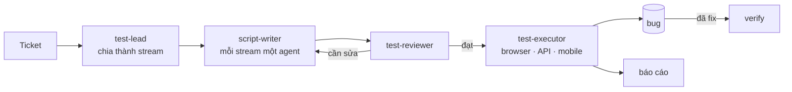

<div align="center">

# testkit

**Đội QA mã nguồn mở cho coding agent của bạn.**
Lập kế hoạch, viết, review và chạy test từ một ticket. Ghi bug kèm bằng chứng và verify bản fix.

[English](README.md) · **Tiếng Việt** · [简体中文](README.zh-CN.md) · [日本語](README.ja.md) · [한국어](README.ko.md)

[](LICENSE)
[](https://agentskills.io/specification)

Dùng được với **Claude Code** · **Codex** · **Cursor** · **Gemini CLI** · **GitHub Copilot**

</div>

---

## Bắt đầu trong 3 bước

**1. Cài lệnh `testkit`** (mỗi máy một lần):

```bash
curl -fsSL https://testkit.example.com/install.sh | bash          # macOS / Linux
```
```powershell
irm https://testkit.example.com/install.ps1 | iex                 # Windows PowerShell
```

**2. Thêm testkit vào dự án:**

```bash
cd my-project
testkit init
```

**3. Mở dự án trong coding agent và test một ticket:**

```text
/testkit-config          trả lời vài câu hỏi (URL, tài khoản test)
/testkit-run PROJ-123    lập kế hoạch → viết → review → chạy → báo cáo
```

Kết quả nằm trong `qa/runs/PROJ-123/`. Kết luận, số liệu và danh sách bug ở file `report.md`.

> `testkit.example.com` là địa chỉ tạm cho tới khi trang cài đặt được publish. Hiện tại hãy clone repo rồi chạy `./install.sh` (Windows: `.\install.ps1`).

## Tôi làm được gì?

Gõ các lệnh này trong coding agent. Ví dụ dùng cú pháp của Claude Code; công cụ khác xem [cách gọi skill](#coding-agent-được-hỗ-trợ).

| Tôi muốn… | Gõ |
|---|---|
| **Test trọn một ticket** | `/testkit-run PROJ-123` |
| Test lại bug sau khi developer fix | `/testkit-verify --ticket PROJ-123` |
| Review spec trước khi bắt đầu code | `/testkit-spec-review PROJ-123` |
| Viết test plan cho một release | `/testkit-plan-release v2.4` |
| Gửi kết quả dạng Word hoặc Excel | `/testkit-export PROJ-123 all --format xlsx` |
| Biến các case đã pass thành test regression tự động | `/testkit-automate PROJ-123` |
| Kiểm tra accessibility, hiệu năng, thay đổi giao diện | `/quality-audits PROJ-123 a11y` |
| Chuẩn bị kịch bản UAT và biên bản nghiệm thu | `/testkit-uat PROJ-123` |
| Viết hướng dẫn sử dụng hoặc release notes từ app thật | `/testkit-guide guide checkout PROJ-123` |
| Xem chỉ số chất lượng của một sprint | `/testkit-metrics sprint-42 --from 2026-11-01 --to 2026-11-14` |
| Cho testkit hiểu dự án của bạn | `/testkit-knowledge learn` |
| Ghi lại một quyết định để không ai phải hỏi lại | `/testkit-knowledge remember "Mã giảm giá không cộng dồn"` |

Test API (Hurl), kiểm tra database và email, sinh dữ liệu test và test mobile (Maestro) tự chạy bên trong `testkit-run` khi ticket cần, không phải gọi riêng.

## Cách hoạt động



- **test-lead** đọc ticket, tài liệu và code, rồi chia việc thành các stream chạy song song được.
- **script-writer** viết test case cho từng stream, có mở trình duyệt xem giao diện thật.
- **test-reviewer** đối chiếu từng kết quả mong đợi với tài liệu, kiểm tra độ phủ edge case và phân quyền.
- **test-executor** chạy case bằng tài khoản test riêng, lưu ảnh chụp và log làm bằng chứng, rồi ghi bug.

Mỗi stream chạy trên một Chrome headless riêng, nên các stream không dùng chung đăng nhập hay dữ liệu.

## Dự án có sẵn và bộ nhớ dự án

- **Không đè lên những gì bạn đã có.** `testkit init` không ghi đè skill, agent hay file của bạn. Skill hoặc agent trùng tên được giữ nguyên, kèm cảnh báo. testkit chỉ thêm một khối ngắn có đánh dấu vào `CLAUDE.md`, `AGENTS.md` hoặc `GEMINI.md`, phần còn lại của file giữ nguyên.
- **Hiểu dự án.** `/testkit-knowledge learn` quét code, đặc tả API, tài liệu và các hướng dẫn agent sẵn có. Kết quả là `qa/knowledge/project-map.md`: tính năng, màn hình, endpoint, vai trò, môi trường và vùng rủi ro.
- **Nhớ các quyết định.** Câu trả lời của PO, hành vi đã được chấp nhận, các bug "won't fix" được lưu thành file trong `qa/knowledge/decisions/`. Agent đọc lại trước khi lập kế hoạch và review, và ghi thêm quyết định mới trong lúc làm.
- **Knowledge graph (không bắt buộc).** testkit đưa toàn bộ kiến thức này vào [Graphiti](https://github.com/getzep/graphiti) để tìm theo ngữ nghĩa. Nếu bạn đã chạy sẵn một Graphiti thì testkit dùng lại, chưa có thì `testkit graph up` khởi động mới (cần Docker và một API key LLM hoặc Ollama). Không có graph thì mọi thứ vẫn chạy bằng file.

## Coding agent được hỗ trợ

`testkit init` tự nhận ra công cụ có trên máy. Muốn tự chọn: `testkit init --agents claude,codex` (hoặc `all`).

| Công cụ | Gọi skill |
|---|---|
| Claude Code | `/testkit-run PROJ-123` |
| Codex | `$testkit-run PROJ-123` |
| Cursor | `/testkit-run PROJ-123` |
| GitHub Copilot | `/testkit-run PROJ-123` |
| Gemini CLI | nhờ: *"dùng skill testkit-run cho PROJ-123"* |

> Codex và Gemini CLI chỉ nạp skill của dự án khi thư mục đã được đánh dấu tin cậy (trusted).

## testkit thêm gì vào dự án

```
my-project/
├── .claude/ .agents/ .codex/ …   skill và agent cho coding agent (testkit quản lý)
└── qa/
    ├── config.yml                môi trường, tài khoản test, trình duyệt, định dạng báo cáo
    ├── runs/PROJ-123/            kế hoạch, test case, review, kết quả, bằng chứng, báo cáo
    ├── bugs/                     mỗi bug một file + index.md
    ├── knowledge/                bản đồ dự án, quyết định, sổ đăng ký tài liệu
    └── accounts.local.json       mật khẩu tài khoản test (git-ignored)
```

Cập nhật bằng `testkit update`, kiểm tra cài đặt bằng `testkit doctor`.

## An toàn mặc định

- Chỉ mở các URL khai báo trong `qa/config.yml`. Thao tác phá hủy bị chặn ở môi trường `allow_write: false`.
- Không đụng tới trình duyệt và tài khoản đăng nhập của bạn; mỗi stream dùng một Chrome mới, tạm thời.
- Đọc database ở chế độ chỉ đọc. Load test và quét bảo mật tắt cho tới khi bạn cho phép một môi trường, và không bao giờ chạy trên production.
- Không để mật khẩu lọt vào báo cáo, và tắt telemetry của trình duyệt.
- Hỏi trước mọi việc tốn tiền hoặc ghi lên Jira.

<details>
<summary><b>Tùy chọn cài đặt</b></summary>

Cài thêm nhóm công cụ cho các loại test khác:

```bash
curl -fsSL https://testkit.example.com/install.sh | bash -s -- --with api,automation
```

| Nhóm | Cài | Dùng cho |
|---|---|---|
| `api` | Hurl | test API |
| `mail` | Mailpit | kiểm tra email / OTP |
| `db` | psql, mysql client | kiểm tra database |
| `automation` | Node.js | bộ regression Playwright |
| `video` | ffmpeg | video cho bug và hướng dẫn |
| `load` | k6 | load test |
| `mobile` | Maestro (cần Java 17+) | test app mobile |
| `security` | kiểm tra Docker | OWASP ZAP baseline |
| `knowledge` | Graphiti trong Docker (tải khoảng 3,7 GB) | knowledge graph |
| `office` | LibreOffice, poppler | xem trước file Word xuất ra |
| `agent-browser` | Node.js, agent-browser | công cụ trình duyệt thay thế |

Dùng `--with all` để cài tất cả, `--yes` để bỏ qua các câu hỏi. Trên Windows, đặt `$env:TESTKIT_WITH = "api,automation"` trước khi chạy installer.

Bản cài cơ bản kiểm tra coding agent (nếu chưa có thì cài Claude Code), cài uv, browser-use CLI, pandoc và kiểm tra Google Chrome. Chi tiết: [docs/installation.md](docs/installation.md).

</details>

<details>
<summary><b>Tất cả skill</b></summary>

| Skill | Dùng để |
|---|---|
| `testkit-run`, `testkit-verify`, `testkit-config`, `testkit-knowledge` | Quy trình chính, verify bug, cấu hình dự án |
| `testkit-spec-review`, `testkit-plan-release` | Review yêu cầu, test plan cho release |
| `test-case-standard`, `test-data` | Định dạng test case và checklist, sinh dữ liệu test |
| `browser-testing`, `api-testing`, `data-checks`, `mobile-testing` | Chạy test trình duyệt, API, database/email, mobile |
| `quality-audits` | Accessibility, hiệu năng, so sánh giao diện, load, bảo mật |
| `bug-reporting` | Định dạng bug, vòng đời, video, ánh xạ Jira |
| `testkit-automate` | Bộ regression Playwright và mẫu CI |
| `testkit-export`, `testkit-metrics`, `testkit-uat`, `testkit-guide` | Xuất Word/Excel/CSV, chỉ số và slide, UAT, tài liệu người dùng |
| `docx`, `pdf`, `xlsx`, `pptx` | Skill tài liệu của [Anthropic](https://github.com/anthropics/skills) (Apache-2.0) |
| `browser-use` | Sinh từ [browser-use](https://github.com/browser-use/browser-use) CLI trên máy bạn |

</details>

## Tài liệu

- [Cài đặt và publish](docs/installation.md)
- [Hướng dẫn sử dụng](docs/usage-guide.md)

## Đóng góp

Chào đón issue và pull request: skill mới, thêm coding agent, bản dịch, sửa lỗi. Xem [CONTRIBUTING.md](CONTRIBUTING.md) và chạy `python3 scripts/check-kit.py` trước khi mở pull request. Vui lòng tuân theo [Quy tắc ứng xử](CODE_OF_CONDUCT.md); lỗ hổng bảo mật xin báo theo [SECURITY.md](SECURITY.md).

## Giấy phép

[MIT](LICENSE). Các skill `docx`, `pdf`, `xlsx`, `pptx` đi kèm thuộc bản quyền Anthropic, giấy phép Apache-2.0. Xem [THIRD_PARTY_NOTICES.md](THIRD_PARTY_NOTICES.md).
