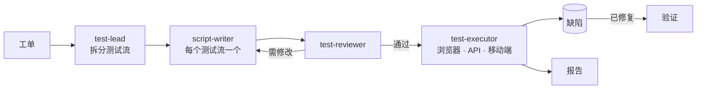

<div align="center">

# testkit

**为你的编程智能体配备一支开源 QA 团队。**
根据工单规划、编写、评审并执行测试。附带证据提交缺陷，并验证修复。

[English](README.md) · [Tiếng Việt](README.vi.md) · **简体中文** · [日本語](README.ja.md) · [한국어](README.ko.md)

[](LICENSE)
[](https://agentskills.io/specification)

支持 **Claude Code** · **Codex** · **Cursor** · **Gemini CLI** · **GitHub Copilot**

</div>

---

## 三步上手

**1. 安装 `testkit` 命令**（每台机器一次）：

```bash
curl -fsSL https://testkit.example.com/install.sh | bash          # macOS / Linux
```
```powershell
irm https://testkit.example.com/install.ps1 | iex                 # Windows PowerShell
```

**2. 在项目中启用 testkit：**

```bash
cd my-project
testkit init
```

**3. 在编程智能体中打开项目，测试一个工单：**

```text
/testkit-config          回答几个问题（URL、测试账号）
/testkit-run PROJ-123    计划 → 编写 → 评审 → 执行 → 报告
```

结果写入 `qa/runs/PROJ-123/`，结论、统计和缺陷列表在 `report.md` 中。

> 在安装站点发布之前，`testkit.example.com` 只是占位地址。目前请克隆仓库后运行 `./install.sh`（Windows：`.\install.ps1`）。

## 我能做什么？

在编程智能体中输入以下命令。示例使用 Claude Code 语法，其他工具见[调用方式](#支持的编程智能体)。

| 我想… | 输入 |
|---|---|
| **完整测试一个工单** | `/testkit-run PROJ-123` |
| 开发修复后复测缺陷 | `/testkit-verify --ticket PROJ-123` |
| 开发开始前评审需求 | `/testkit-spec-review PROJ-123` |
| 为一个版本编写测试计划 | `/testkit-plan-release v2.4` |
| 以 Word 或 Excel 发送结果 | `/testkit-export PROJ-123 all --format xlsx` |
| 把通过的用例变成自动化回归测试 | `/testkit-automate PROJ-123` |
| 检查无障碍、性能或界面变化 | `/quality-audits PROJ-123 a11y` |
| 准备 UAT 脚本和验收纪要 | `/testkit-uat PROJ-123` |
| 根据真实应用编写用户手册或发布说明 | `/testkit-guide guide checkout PROJ-123` |
| 查看一个迭代的质量指标 | `/testkit-metrics sprint-42 --from 2026-11-01 --to 2026-11-14` |
| 让 testkit 了解你的项目 | `/testkit-knowledge learn` |
| 记录一个产品决策，避免再次询问 | `/testkit-knowledge remember "优惠码不能叠加"` |

API 测试（Hurl）、数据库和邮件检查、测试数据和移动端测试（Maestro）会在工单需要时自动在 `testkit-run` 中运行，无需单独调用。

## 工作原理



- **test-lead** 阅读工单、文档和代码，把工作拆成可并行的测试流。
- **script-writer** 为每个测试流编写用例，并在浏览器中查看实际界面。
- **test-reviewer** 对照文档核对每个预期结果，检查边界情况和权限的覆盖度。
- **test-executor** 使用专用测试账号执行用例，保存截图和日志作为证据，并提交缺陷。

每个测试流都在独立的无头 Chrome 中运行，互不共享登录和数据。

## 已有项目与项目记忆

- **与现有内容和平共处。** `testkit init` 不会覆盖你自己的 skill、agent 或文件。同名的 skill 或 agent 会保留，并给出警告。testkit 只在 `CLAUDE.md`、`AGENTS.md` 或 `GEMINI.md` 中添加一段带标记的简短内容，文件其余部分保持不变。
- **理解项目。** `/testkit-knowledge learn` 扫描代码、API 规范、文档和已有的智能体说明，生成 `qa/knowledge/project-map.md`：功能、页面、接口、角色、环境和高风险区域。
- **记住决策。** PO 的回答、已认可的行为和"不修复"的结论会保存为 `qa/knowledge/decisions/` 中的文件。智能体在计划和评审前会查阅，并在工作中记录新的决策。
- **知识图谱（可选）。** testkit 会把这些内容索引到 [Graphiti](https://github.com/getzep/graphiti) 知识图谱中，支持按语义搜索。已有运行中的 Graphiti 就直接复用，没有则用 `testkit graph up` 启动一个（需要 Docker，以及 LLM API key 或 Ollama）。没有图谱时一切仍基于文件正常工作。

## 支持的编程智能体

`testkit init` 会自动识别本机的工具。也可以手动指定：`testkit init --agents claude,codex`（或 `all`）。

| 工具 | 调用 skill |
|---|---|
| Claude Code | `/testkit-run PROJ-123` |
| Codex | `$testkit-run PROJ-123` |
| Cursor | `/testkit-run PROJ-123` |
| GitHub Copilot | `/testkit-run PROJ-123` |
| Gemini CLI | 直接说：*"用 testkit-run skill 测试 PROJ-123"* |

> Codex 和 Gemini CLI 只在被标记为受信任（trusted）的目录中加载项目 skill。

## testkit 会在项目中添加什么

```
my-project/
├── .claude/ .agents/ .codex/ …   给编程智能体的 skill 和 agent（由 testkit 管理）
└── qa/
    ├── config.yml                环境、测试账号、浏览器、报告格式
    ├── runs/PROJ-123/            计划、用例、评审、结果、证据、报告
    ├── bugs/                     每个缺陷一个文件 + index.md
    ├── knowledge/                项目地图、决策、文档登记
    └── accounts.local.json       测试账号密码（已 git-ignore）
```

用 `testkit update` 更新，用 `testkit doctor` 检查安装。

## 默认安全

- 只访问 `qa/config.yml` 中列出的 URL。在 `allow_write: false` 的环境中拦截破坏性操作。
- 不动你自己的浏览器和登录状态，每个测试流使用全新的临时 Chrome。
- 数据库只读。负载测试和安全扫描默认关闭，需你明确允许某个环境，且绝不在生产环境运行。
- 报告中不出现密码，并关闭浏览器遥测。
- 涉及费用或写入 Jira 之前会先询问。

<details>
<summary><b>安装选项</b></summary>

为更多测试类型安装工具组：

```bash
curl -fsSL https://testkit.example.com/install.sh | bash -s -- --with api,automation
```

| 工具组 | 安装 | 用途 |
|---|---|---|
| `api` | Hurl | API 测试 |
| `mail` | Mailpit | 邮件 / OTP 检查 |
| `db` | psql、mysql 客户端 | 数据库检查 |
| `automation` | Node.js | Playwright 回归套件 |
| `video` | ffmpeg | 缺陷和手册视频 |
| `load` | k6 | 负载测试 |
| `mobile` | Maestro（需 Java 17+） | 移动应用测试 |
| `security` | 检查 Docker | OWASP ZAP 基线扫描 |
| `knowledge` | Docker 中的 Graphiti（下载约 3.7 GB） | 知识图谱 |
| `office` | LibreOffice、poppler | 预览导出的 Word |
| `agent-browser` | Node.js、agent-browser | 备选浏览器工具 |

`--with all` 安装全部，`--yes` 跳过确认。Windows 上请在运行安装程序前设置 `$env:TESTKIT_WITH = "api,automation"`。

基础安装会检查编程智能体（没有时安装 Claude Code），安装 uv、browser-use CLI 和 pandoc，并检查 Google Chrome。详见 [docs/installation.md](docs/installation.md)。

</details>

<details>
<summary><b>全部 skill</b></summary>

| Skill | 用途 |
|---|---|
| `testkit-run`、`testkit-verify`、`testkit-config`、`testkit-knowledge` | 主流程、缺陷验证、项目配置 |
| `testkit-spec-review`、`testkit-plan-release` | 需求评审、版本测试计划 |
| `test-case-standard`、`test-data` | 用例格式与检查清单、测试数据生成 |
| `browser-testing`、`api-testing`、`data-checks`、`mobile-testing` | 执行浏览器、API、数据库/邮件、移动端测试 |
| `quality-audits` | 无障碍、性能、视觉对比、负载、安全 |
| `bug-reporting` | 缺陷格式、生命周期、视频、Jira 映射 |
| `testkit-automate` | Playwright 回归套件和 CI 模板 |
| `testkit-export`、`testkit-metrics`、`testkit-uat`、`testkit-guide` | Word/Excel/CSV 导出、指标与幻灯片、UAT、用户文档 |
| `docx`、`pdf`、`xlsx`、`pptx` | 来自 [Anthropic](https://github.com/anthropics/skills) 的文档 skill（Apache-2.0） |
| `browser-use` | 由本机的 [browser-use](https://github.com/browser-use/browser-use) CLI 生成 |

</details>

## 文档

- [安装与发布](docs/installation.md)
- [使用指南](docs/usage-guide.md)

详细文档目前为越南语，欢迎贡献翻译。

## 参与贡献

欢迎提交 issue 和 pull request：新 skill、支持更多编程智能体、翻译、修复。请阅读 [CONTRIBUTING.md](CONTRIBUTING.md)，提交 pull request 前运行 `python3 scripts/check-kit.py`。请遵守[行为准则](CODE_OF_CONDUCT.md)，安全漏洞请按 [SECURITY.md](SECURITY.md) 报告。

## 许可证

[MIT](LICENSE)。内置的 `docx`、`pdf`、`xlsx`、`pptx` skill 版权归 Anthropic 所有，采用 Apache-2.0。详见 [THIRD_PARTY_NOTICES.md](THIRD_PARTY_NOTICES.md)。
