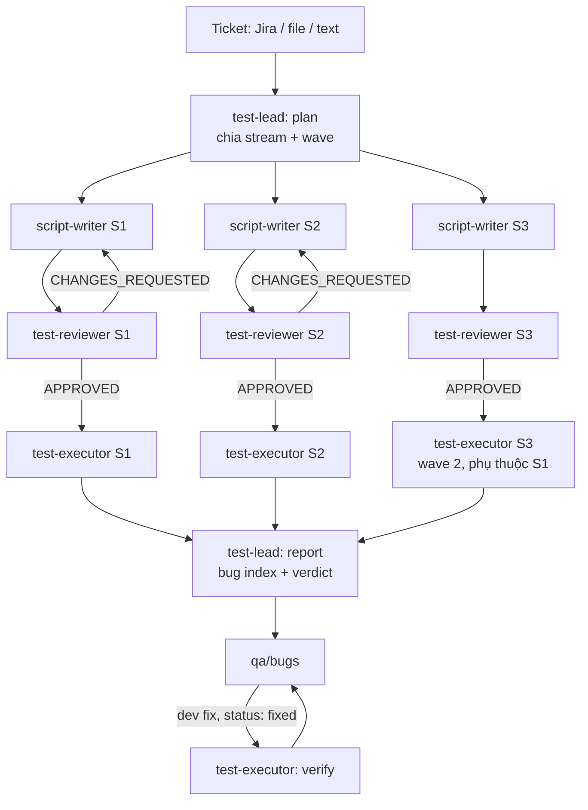

# Hướng dẫn sử dụng testkit

## Luồng tổng thể



Phiên chính của coding agent (skill `testkit-run`) đóng vai điều phối: nó đọc `plan.md` của test-lead rồi khởi động writer, reviewer, executor. Test-lead chỉ lập kế hoạch và tổng hợp. Thiết kế này dùng được với mọi công cụ, vì Claude Code và Gemini CLI không cho subagent gọi subagent khác. Nếu công cụ không có subagent, phiên chính tự đóng từng vai theo file vai trò, lần lượt từng stream.

## Khi nào hai luồng được chạy song song

Test-lead chỉ coi hai stream là độc lập khi thỏa cả bốn điều kiện:

1. Không ghi vào cùng bản ghi. Mỗi stream có tài khoản và dữ liệu riêng.
2. Không stream nào cần kết quả của stream kia.
3. Không đổi trạng thái toàn cục mà stream kia đọc, ví dụ cài đặt hệ thống, feature flag, quota chung.
4. Chạy cùng lúc không gây flaky, ví dụ do rate limit, dùng chung inbox, job chạy đơn lẻ.

Thiếu điều kiện nào thì gộp hai stream lại hoặc thêm `depends_on`. Stream đổi cài đặt toàn cục luôn chạy riêng, ở wave cuối.

## Cấu trúc `qa/` trong dự án

```
qa/
├── config.yml                  # môi trường, đường dẫn docs/code, chiến lược tạo tài khoản, tracker
├── accounts.local.json         # tài khoản test đã tạo (git-ignored)
├── bugs/
│   ├── index.md                # bảng tổng hợp bug, chỉ test-lead ghi
│   ├── BUG-PROJ-123-S2-01.md
│   └── evidence/BUG-.../       # bằng chứng khi verify
└── runs/PROJ-123/
    ├── plan.md                 # test-lead
    ├── cases/S1.md             # script-writer
    ├── reviews/S1.md           # test-reviewer
    ├── results/S1.md           # test-executor
    ├── evidence/S1/*.png       # screenshot, console, network
    └── report.md               # test-lead
```

## Trình duyệt

Mặc định testkit dùng [browser-use](https://github.com/browser-use/browser-use) CLI. Agent gọi nó qua `.claude/skills/browser-testing/scripts/bu-session.sh`, mỗi stream một phiên riêng tên `<RUN_ID>-<STREAM_ID>`. Chọn chế độ bằng `browser.mode` trong `qa/config.yml`:

| Chế độ | Chạy gì | Song song | Chi phí | Khi nào dùng |
|---|---|---|---|---|
| `isolated` (mặc định) | Mỗi stream một Chrome headless riêng, profile tạm, cổng debug riêng | Có | Miễn phí | Hầu hết trường hợp, kể cả localhost |
| `cloud` | Mỗi stream một trình duyệt Browser Use Cloud | Có | Tính phí theo giờ | Máy chủ không có Chrome, hoặc cần IP sạch. Không vào được localhost nếu không có tunnel |
| `local` | Chrome đang mở của bạn, kèm các phiên đăng nhập | Không, từng stream một | Miễn phí | Ứng dụng chỉ đăng nhập được bằng SSO trên Chrome của bạn |

Agent thu bằng chứng bằng `tk_evidence(...)`: chụp màn hình và ghi lại console error, exception, request lỗi (HTTP ≥ 400) vào file `.json` cạnh ảnh. Telemetry của browser-use bị tắt trong các phiên testkit để URL nội bộ không bị gửi ra ngoài.

Muốn dùng `agent-browser` thay thế: cài bằng `--with-agent-browser` rồi đặt `browser.tool: agent-browser`.

## Tài liệu Word

**Spec dạng .docx.** Nếu ticket đính kèm file Word, hoặc `docs.paths` chứa file `.docx`, test-lead chuyển chúng sang markdown bằng pandoc vào `qa/runs/<RUN_ID>/sources/`, kèm ảnh trong `sources/media/`. Writer và reviewer đọc bản chuyển đổi đó và trích dẫn theo dạng `<file>.docx § <heading>`. Tracked change hoặc comment chưa được chấp nhận trong spec được coi là câu hỏi mở, không phải yêu cầu. File `.doc` cũ cần LibreOffice để chuyển sang `.docx` trước.

**Xuất báo cáo Word.** Chạy `/testkit-export <RUN_ID>` để có `qa/runs/<RUN_ID>/export/<RUN_ID>-report.docx`. Báo cáo gồm kết luận, số liệu theo stream, độ phủ AC, bug kèm ảnh bằng chứng, các case bị chặn và câu hỏi mở. Ngoài ra có `cases` (bảng test case, khổ ngang) và `bugs` (danh sách bug). Thêm `docx` vào `report.formats` trong `qa/config.yml` để file Word tự được xuất sau mỗi lần `/testkit-run`.

File được render bằng python-docx (qua `uv run`, không cần Node), sau đó kiểm tra bằng `validate.py` của skill docx. Nếu máy có LibreOffice, agent còn render thành ảnh để xem trước.

## Các nghiệp vụ khác của tester

Ngoài quy trình chính (`testkit-run`, `testkit-verify`), kit có các skill sau. Gọi theo cú pháp của coding agent, ví dụ `/tên-skill` trong Claude Code hoặc `$tên-skill` trong Codex.

| Việc | Skill | Kết quả |
|---|---|---|
| Review spec trước khi code xong | `testkit-spec-review <ticket>` | `qa/specs/<ID>/review.md`: AC, chỗ mơ hồ, mâu thuẫn, câu hỏi cho PO |
| Test plan cho release/sprint | `testkit-plan-release <fixVersion\|JQL\|danh sách ticket>` | `qa/releases/<R>/test-plan.md` (+ Word), ma trận rủi ro, ước lượng công |
| Sinh dữ liệu test | `test-data` | JSON/CSV/Hurl, có locale `vi_VN` và bộ giá trị biên |
| Test API | `api-testing` (case `Type: api`) | file `.hurl`, kết quả JUnit/JSON trong evidence |
| Kiểm tra DB, email, OTP | `data-checks` | truy vấn chỉ đọc có che dữ liệu cá nhân, đọc OTP/link từ Mailpit |
| Test app mobile | `mobile-testing` (case `Type: mobile`) | flow Maestro, ảnh chụp, JUnit |
| Accessibility, hiệu năng, so sánh giao diện, load, bảo mật | `quality-audits` | `qa/runs/<RUN>/audits/*/summary.md`; load và bảo mật chỉ chạy trên môi trường trong `audits.*.allowed_envs` |
| Regression tự động | `testkit-automate` | bộ Playwright trong `qa/automation/`, tag `@smoke`, mẫu CI GitHub/GitLab |
| Xuất Word/Excel/TestRail/Xray | `testkit-export <RUN> [report\|cases\|bugs\|results\|all] --format docx\|xlsx\|testrail-csv\|xray-csv` | file trong `qa/runs/<RUN>/export/` |
| Báo cáo chất lượng sprint/release | `testkit-metrics` | Markdown, Word, slide |
| UAT và nghiệm thu | `testkit-uat` | kịch bản UAT (Excel), biên bản nghiệm thu (Word) |
| User guide, release notes, FAQ, video | `testkit-guide` | `qa/guides/<NAME>/`, ảnh chụp có đánh dấu, video MP4 |

## Tài khoản test

Cấu hình trong `qa/config.yml` → `accounts.strategy`:

| Strategy | Cách tạo | Khi nào dùng |
|---|---|---|
| `signup` | Đăng ký qua UI của app | Mặc định, app có trang đăng ký |
| `api` | Gọi endpoint tạo user, token đọc từ biến môi trường | Có API nội bộ cho test |
| `command` | Chạy lệnh seed, ví dụ `pnpm seed:user ...` | Chạy local hoặc có quyền truy cập DB |
| `pool` | Lấy tài khoản có sẵn trong `qa/accounts.local.json` | Môi trường không cho tạo user |

Email theo mẫu `qa+{run}-{stream}-{role}-{ts}@example.test` để mỗi stream có tài khoản riêng. Nếu đăng ký cần OTP qua email, khai báo `accounts.inbox` (Mailpit, MailHog…). Nếu không có inbox, các case liên quan được đánh `BLOCKED` thay vì đoán.

## Vòng đời bug

```
open → fixed (developer sửa file bug hoặc báo qua Jira) → verified
                                                       ↘ reopened → fixed → …
```

Developer đổi `status: fixed` và điền `fixed_in` trong file bug, hoặc nói với Claude "bug X đã fix ở commit Y". Sau đó chạy `/testkit-verify`. Executor chạy lại các bước tái hiện, case gốc, các case liên quan và một vòng regression nhỏ, rồi cập nhật trạng thái kèm bằng chứng.

## Tùy chọn của `testkit-run`

| Tùy chọn | Ý nghĩa |
|---|---|
| `--env staging` | Chọn môi trường trong config |
| `--streams S1,S3` | Chỉ chạy một số stream |
| `--only plan\|write\|review\|execute\|report` | Chỉ chạy một bước |

Chạy lại cùng ticket sẽ tiếp tục từ bước còn dang dở, dựa trên các file đã có trong `qa/runs/<RUN_ID>/`.

## An toàn

- Agent chỉ mở các URL thuộc môi trường khai báo trong config.
- Môi trường đặt `allow_write: false` thì các case có thao tác phá hủy được đánh `BLOCKED`.
- Mật khẩu chỉ nằm trong `qa/accounts.local.json`. Kết quả và bug report dùng placeholder như `{{member.password}}`.
- Trước lần chạy đầu tiên lên một môi trường cho phép ghi, phiên điều phối báo cho người dùng biết môi trường nào sẽ nhận dữ liệu test. Với Jira, Claude hỏi trước khi tạo issue.
